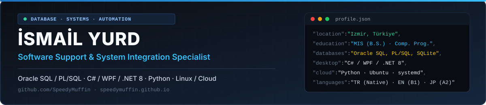
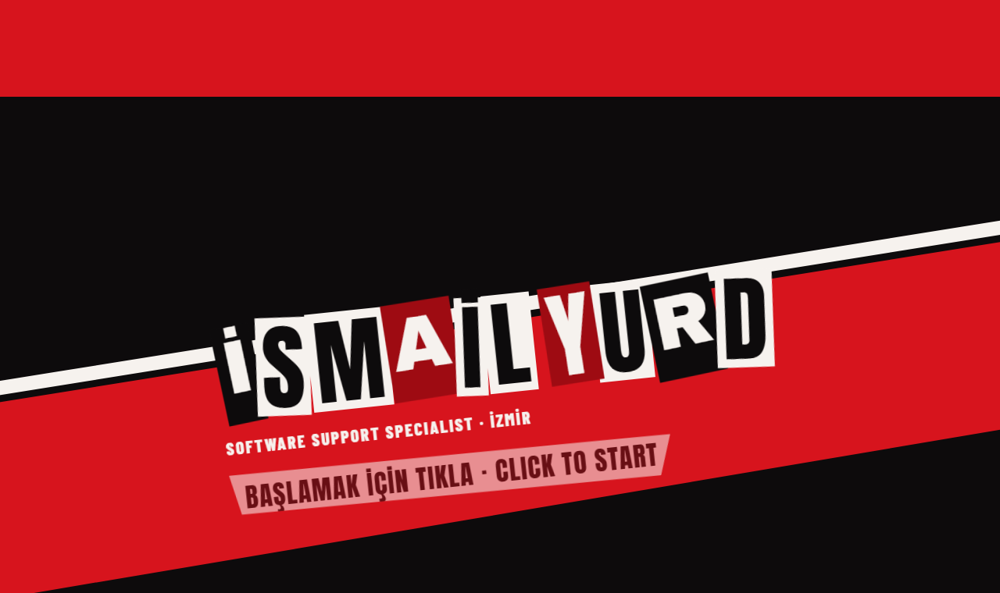

  

  
  
  
  

---

## About Me

Software Support &amp; System Integration Specialist with 2 years of hands-on experience on live **Hospital Information Systems (HIS)**, tracing issues end-to-end from application screens down to the **Oracle database** using SQL/PL/SQL analysis and custom reporting. Outside daily support, I build Windows automation tools in **C# / .NET** and run 24/7 **Python** services on **Oracle Cloud (Ubuntu / systemd)**.

- **Education:** A.S. Computer Programming (MCBÜ) · B.S. Management Information Systems (Anadolu University, ongoing)
- **Focus Areas:** Oracle SQL / PL/SQL, Windows System Automation (`Active Directory`, `WMI`, `PowerShell`), Telemetry &amp; Protocol Tooling (`MQTT`, `HL7 v2`, `RS-232`), and Linux/Cloud pipelines

---

## Featured Projects

<table>
  <tr>
    <td width="50%" valign="top">
      <h3>🛠️ <a href="https://github.com/SpeedyMuffin/OtoProgram">OtoProgram</a></h3>
      
      
<strong>C# · WPF / XAML · .NET 8 · Active Directory · WMI</strong>

      
Enterprise setup and Windows system automation assistant: unattended software deployment, domain join, AD user management, remote WMI hardware/service diagnostics, process &amp; printer control, profile backup, LAN chat, and an offline <strong>Demo Mode</strong>.

    </td>
    <td width="50%" valign="top">
      <h3>📡 <a href="https://github.com/SpeedyMuffin/ward-telemetry-monitor">Ward Telemetry Monitor (v1.2.0)</a></h3>
      
      
<strong>R&amp;D / PoC · Bilingual TR/EN Web UI · Win32 RS-232 · MQTT 3.1.1 · HL7 v2</strong>

      
Single-binary device telemetry and HL7 v2 monitoring station prototype with embedded HTTP server, DERS dose safety limits, 24h fluid balance CSV reporting, password-protected Admin Panel with custom header branding, and offline Ed25519 licensing.

    </td>
  </tr>
  <tr>
    <td width="50%" valign="top">
      <h3>🎨 <a href="https://speedymuffin.github.io/">Interactive Portfolio</a></h3>
      
      
<strong>HTML · CSS · Vanilla JS · Web Audio API (<a href="https://github.com/SpeedyMuffin/speedymuffin.github.io">Repo</a>)</strong>

      
Personal bilingual (<strong>TR / EN</strong>) portfolio inspired by <em>Persona 5</em> menus, featuring a synthesized background theme generated live in-browser with the Web Audio API and zero external frameworks.

    </td>
    <td width="50%" valign="top">
      <h3>☁️ Autonomous Cloud &amp; Media Pipelines</h3>
      
<strong>Python · FFmpeg · Gemini API · YouTube Data API · Linux / systemd</strong>

      <ul>
        <li>End-to-end automated video production &amp; publishing pipelines running 24/7 on <strong>Oracle Cloud ARM (Ubuntu)</strong> with <code>systemd</code>, Nginx, and Cloudflare (<strong>150+ videos</strong> published).</li>
        <li>Telegram approval workflow (auto-publish after 30 min fallback), faster-whisper word-level subtitles, and automated TTS/FFmpeg composition.</li>
        <li>Public landing &amp; policy pages: <a href="https://github.com/SpeedyMuffin/unveiled-echoes">unveiled-echoes</a></li>
      </ul>
    </td>
  </tr>
</table>

---

## Tech Stack

  
  
  
  
  
  

  
  
  
  
  
  
  

---

## GitHub Activity

  

